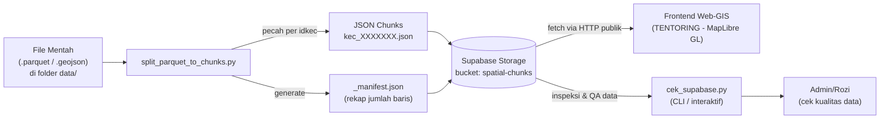
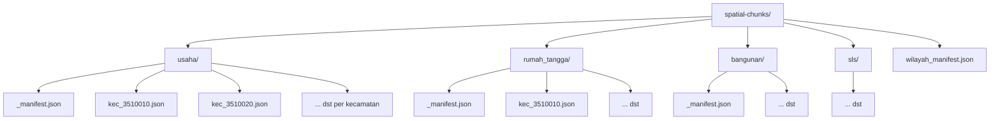
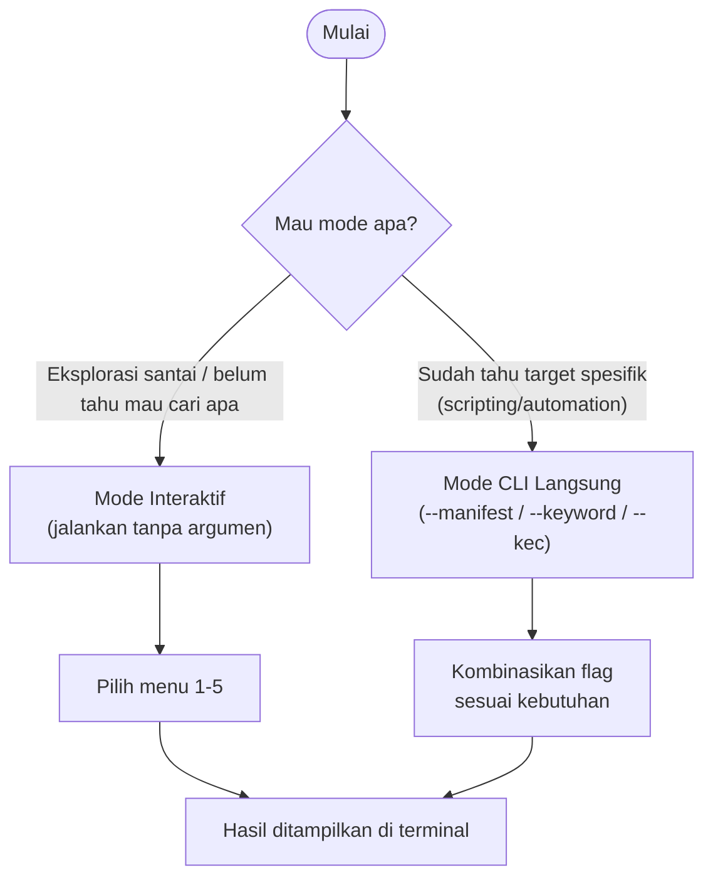

# Pipeline Data Spasial SE2026 — TENTORING

> Dokumentasi arsitektur dan cara pakai pipeline pemrosesan data spasial (Parquet → JSON Chunks) serta tools inspeksi data di **Supabase Storage** untuk keperluan SE2026 (Sensus Ekonomi 2026) BPS Kabupaten Banyuwangi.

---

## Daftar Isi

1. [Ringkasan & Tujuan](#1-ringkasan--tujuan)
2. [Arsitektur & Alur Data](#2-arsitektur--alur-data)
3. [Struktur Bucket Supabase Storage](#3-struktur-bucket-supabase-storage)
4. [Upload Data — `split_parquet_to_chunks.py`](#4-upload-data--split_parquet_to_chunkspy)
5. [Inspeksi Data — `cek_supabase.py`](#5-inspeksi-data--cek_supabasepy)
6. [Referensi URL Public Storage](#6-referensi-url-public-storage)
7. [Catatan Keamanan](#7-catatan-keamanan)

---

## 1. Ringkasan & Tujuan

Aplikasi frontend Web-GIS (TENTORING) butuh loading peta yang cepat, sementara dataset mentah (Parquet/GeoJSON) untuk seluruh Kabupaten Banyuwangi bisa berukuran puluhan-ratusan MB. Kalau di-load sekaligus, browser akan lag berat.

**Solusinya:** dataset dipecah (chunking) berdasarkan **Kecamatan (`idkec`)**, jadi setiap kecamatan punya file JSON kecil sendiri. Frontend cukup fetch file kecamatan yang sedang dilihat user di peta — bukan seluruh Kabupaten sekaligus.

Ada 2 script utama yang saling melengkapi:

| Script                       | Fungsi                                                                                                    |
| ---------------------------- | --------------------------------------------------------------------------------------------------------- |
| `split_parquet_to_chunks.py` | **Menulis** — memecah Parquet jadi JSON per-kecamatan lalu upload ke Supabase Storage                     |
| `cek_supabase.py`            | **Membaca** — mengecek/inspeksi data yang sudah tersimpan di Storage, tanpa perlu buka Supabase Dashboard |

---

## 2. Arsitektur & Alur Data

Berikut gambaran alur data dari file mentah di komputer lokal sampai tampil di peta frontend:



**Penjelasan alur:**

1. File mentah (`.parquet`) hasil ekspor dari database (misal `asn_census` atau data usaha SE2026) disimpan di folder lokal `data/`.
2. `split_parquet_to_chunks.py` membaca file itu, mengelompokkan baris berdasarkan `idkec`, lalu menyimpannya jadi banyak file JSON kecil (satu file = satu kecamatan).
3. Bersamaan dengan itu, script juga membuat `_manifest.json` — semacam "daftar isi" yang mencatat total baris dan rincian per kecamatan, supaya frontend tahu chunk mana yang perlu di-fetch tanpa harus download semua file dulu.
4. Semua file (chunks + manifest) diunggah ke Supabase Storage bucket `spatial-chunks`.
5. Frontend TENTORING mengambil data langsung dari URL publik Storage sesuai kecamatan yang sedang aktif di peta.
6. Untuk keperluan QA/pengecekan data (tanpa buka dashboard Supabase satu-satu), dipakai `cek_supabase.py` yang fetch data yang sama secara real-time via HTTP.

---

## 3. Struktur Bucket Supabase Storage

Setiap jenis data punya sub-folder sendiri di dalam bucket `spatial-chunks`, dan masing-masing punya manifest sendiri:



**Poin penting:**

- Nama file chunk selalu berformat `kec_<idkec>.json`, contoh: `kec_3510010.json` untuk Kecamatan dengan kode `3510010`.
- `_manifest.json` ada di setiap sub-folder dataset, isinya rekap total baris dan daftar per kecamatan — berguna untuk validasi cepat tanpa buka satu-satu chunk.
- `wilayah_manifest.json` di level root bucket kemungkinan menyimpan mapping wilayah (kecamatan/desa) secara keseluruhan.

---

## 4. Upload Data — `split_parquet_to_chunks.py`

Script ini bertugas memproses file Parquet/GeoJSON lokal, memecahnya jadi JSON chunks per-kecamatan, lalu mengunggahnya ke Supabase Storage.

### A. Upload Seluruh Dataset (Full Pipeline)

Dipakai kalau ingin memproses ulang **semua** dataset (`usaha`, `usaha_digital`, `rumah_tangga`, `bangunan`, `sls`) dari awal:

```powershell
.\venv\Scripts\python.exe split_parquet_to_chunks.py --upload
```

### B. Upload Dataset/File Spesifik (Direkomendasikan untuk Update Data)

Kalau cuma ada file data baru — misal `data/data-usaha-biasa-2.parquet` — dan hanya ingin update sub-folder **`usaha/`** saja, tanpa mengganggu dataset lain:

```powershell
.\venv\Scripts\python.exe split_parquet_to_chunks.py --dataset usaha --file data/data-usaha-biasa-2.parquet --upload
```

> Mode ini lebih aman untuk update data harian/mingguan karena tidak menyentuh dataset lain yang sudah stabil.

### Opsi Parameter CLI

| Parameter         | Opsi / Contoh                                     | Deskripsi                                                                                   |
| ----------------- | ------------------------------------------------- | ------------------------------------------------------------------------------------------- |
| `--upload`        | _(flag)_                                          | Otomatis mengunggah hasil chunk ke Supabase Storage setelah proses selesai.                 |
| `--dataset`, `-d` | `usaha`, `rumah_tangga`, `bangunan`, `sls`, `all` | Memilih dataset spesifik yang ingin diproses. Default: `all`.                               |
| `--file`, `-f`    | `data/data-usaha-biasa-2.parquet`                 | Path file Parquet kustom yang ingin diproses (menggantikan sumber default).                 |
| `--no-download`   | _(flag)_                                          | Melewati proses download otomatis raw data dari Supabase jika file belum tersedia di lokal. |

---

## 5. Inspeksi Data — `cek_supabase.py`

Script ini dipakai untuk mengecek data yang **sudah ter-upload** di Supabase Storage secara real-time via HTTP — tanpa perlu login ke Supabase Dashboard.

### A. Mode 1 — Menu Interaktif

Jalankan tanpa argumen apapun untuk masuk ke menu interaktif:

```powershell
.\venv\Scripts\python.exe cek_supabase.py
```

**Fitur di dalam menu:**

| No  | Fitur                                  | Fungsi                                                             |
| --- | -------------------------------------- | ------------------------------------------------------------------ |
| 1   | Cari berdasarkan Kata Kunci            | Mencari nama usaha, alamat, nama pemilik, dll di seluruh kecamatan |
| 2   | Lihat Ringkasan Manifest               | Melihat total baris & rincian jumlah data per kecamatan            |
| 3   | Lihat Detail Per Kecamatan & Per Baris | Menampilkan isi data baris demi baris untuk kecamatan tertentu     |
| 4   | Tampilkan Sampel Semua Data            | Preview beberapa baris teratas dari setiap kecamatan sekaligus     |
| 5   | Ganti Dataset                          | Pindah antar dataset: `usaha`, `rumah_tangga`, `bangunan`, `sls`   |

### B. Mode 2 — Perintah CLI Langsung

#### 1. Ringkasan Manifest (Total Data per Kecamatan)

```powershell
.\venv\Scripts\python.exe cek_supabase.py --manifest
```

Untuk dataset lain, tambahkan `--dataset`:

```powershell
.\venv\Scripts\python.exe cek_supabase.py --dataset rumah_tangga --manifest
```

#### 2. Pencarian Berdasarkan Kata Kunci (Keyword Search)

Mencari nama usaha atau nama pemilik di **seluruh kecamatan** sekaligus:

```powershell
.\venv\Scripts\python.exe cek_supabase.py --keyword "Diki Hafish"
```

```powershell
.\venv\Scripts\python.exe cek_supabase.py --keyword "SRIAH"
```

#### 3. Detail Per Kecamatan & Per Baris

- **N baris pertama** kecamatan tertentu (contoh: 5 baris pertama Kec `3510010`):

  ```powershell
  .\venv\Scripts\python.exe cek_supabase.py --kec 3510010 --limit 5
  ```

- **Rentang baris tertentu** (contoh: baris ke-11 sampai ke-20):

  ```powershell
  .\venv\Scripts\python.exe cek_supabase.py --kec 3510010 --limit 10 --offset 10
  ```

- **Paginasi interaktif** (scroll per 10 baris, tekan ENTER untuk lanjut):

  ```powershell
  .\venv\Scripts\python.exe cek_supabase.py --kec 3510010 --interactive
  ```

- **Seluruh baris** di satu kecamatan (tanpa limit):

  ```powershell
  .\venv\Scripts\python.exe cek_supabase.py --kec 3510010 --limit 0
  ```

### Alur Kerja Kedua Mode



---

## 6. Referensi URL Public Storage

Base URL Supabase Storage:

```
https://xecqftjhqonemrrtcjzp.supabase.co/storage/v1/object/public/spatial-chunks/
```

| Jenis Data              | Contoh URL                                  |
| ----------------------- | ------------------------------------------- |
| Manifest Usaha          | `.../spatial-chunks/usaha/_manifest.json`   |
| Chunk Usaha Kec 3510010 | `.../spatial-chunks/usaha/kec_3510010.json` |

> Pola URL: `{BASE_URL}/{nama_dataset}/{nama_file}` — tinggal ganti `nama_dataset` (`usaha`, `rumah_tangga`, `bangunan`, `sls`) dan `nama_file` (`_manifest.json` atau `kec_<idkec>.json`) sesuai kebutuhan.

---

## 7. Catatan Keamanan

- URL di atas mengarah ke bucket **public** (`/object/public/...`), sehingga aman untuk dicantumkan di dokumentasi/README yang bersifat publik.
- **Jangan pernah** menaruh Supabase _service role key_, `.env`, atau connection string database di file dokumentasi maupun kode yang di-commit ke repo publik.
- Kalau bucket ini nantinya diubah jadi private, pastikan dokumentasi ini diperbarui juga supaya tidak menyesatkan pembaca.

---

_Dokumentasi ini dibuat untuk mendukung pipeline data spasial SE2026 (Sensus Ekonomi 2026) — BPS Kabupaten Banyuwangi._
