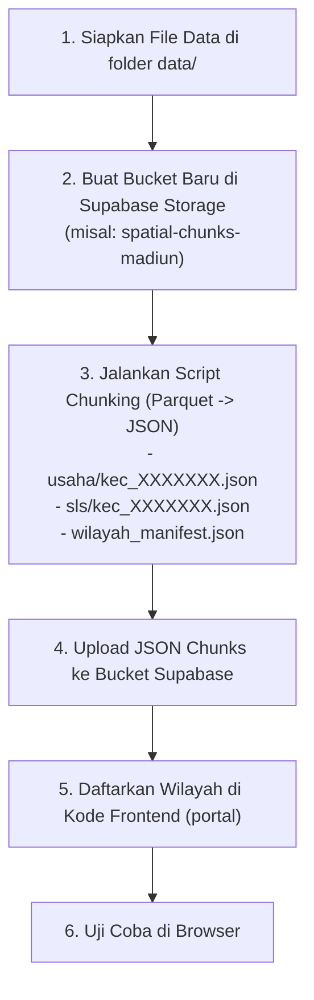

# Panduan Menambahkan Kabupaten/Kota Baru — Web-GIS TENTORING SE2026

Dokumen ini berisi panduan teknis lengkap mengenai kebutuhan data, penanganan kondisi data (misal: hanya memiliki titik koordinat), arsitektur bucket storage, serta langkah-langkah *step-by-step* untuk menambahkan kabupaten/kota baru ke dalam sistem Web-GIS TENTORING SE2026.

---

## 1. Menjawab Pertanyaan: Bisakah Hanya Menyediakan Titik Koordinat Saja?

### **Jawabannya: BISA, namun dengan beberapa catatan fungsionalitas.**

Titik koordinat usaha/bangunan/keluarga sudah **cukup** untuk menampilkan sebaran spasial di peta, heatmap, cluster marker, serta popup informasi usaha. 

Namun, ada beberapa fitur Web-GIS yang **memerlukan poligon** agar bekerja maksimal. Berikut perbandingannya:

| Fitur di Portal Web-GIS | Hanya Titik Koordinat Saja | Titik Koordinat + Poligon SLS & Batas Wilayah |
| :--- | :---: | :---: |
| **Marker Titik Usaha / Bangunan** |  **Bisa** (Muncul titik di peta) |  **Bisa** (Muncul titik di peta) |
| **Filter per Kecamatan & Kelurahan** |  **Bisa** (Selama ada kolom `idkec` / `iddesa` / `idsls`) |  **Bisa** |
| **Detail & Popup Usaha saat Titik Diklik** |  **Bisa** (Nama, alamat, kategori muncul) |  **Bisa** |
| **Arsiran & Garis Poligon SLS (RT/RW)** | ❌ *Tidak Tampil* (Peta hanya menampilkan basemap & titik) |  **Tampil** (Ada batas wilayah RT/RW bergaris) |
| **Tabel Rincian SLS (`SlsDetailTable`)** | ⚠️ *Kosong* (Tabel di-generate dari GeoJSON poligon SLS) |  **Lengkap** (Tabel rekap progres per SLS muncul) |
| **Filter Dropdown Dusun & SLS/RT/RW** | ⚠️ *Hanya 'Semua RT/RW'* |  **Lengkap** (Daftar RT/RW terisi otomatis) |
| **Analisis Beban Kerja & Klaster SLS** | ⚠️ *Terbatas pada titik/K-Means* |  **Lengkap** (Bisa alokasi beban per bidang SLS) |
| **Auto-Zoom & Outline Batas Wilayah** | ⚠️ *Zoom manual / titik tengah* |  **Auto-fit** pas ke bentuk batas desa/kabupaten |

> **Kesimpulan:** 
> - Jika saat ini baru ada titik koordinat (seperti file `usaha-biasa-madiun.parquet`), Anda **sudah bisa menampilkannya di peta** dengan memecahnya per kecamatan dan menyediakan `wilayah_manifest.json`.
> - Namun, untuk mendapatkan pengalaman penuh (tabel SLS, filter RT/RW, dan batas bidang wilayah), **data poligon SLS sangat disarankan untuk dilengkapi**.

---

## 2. Checklist Kebutuhan Data per Kabupaten/Kota

Setiap penambahan wilayah baru (contoh: Kota Madiun - kode BPS `3577`), berikut rincian kebutuhan datanya:

### A. Data Wajib (Core Data Titik)
1. **File Titik Koordinat Parquet/GeoJSON** (di folder `data/<nama_kota>/`):
   - Kolom yang dibutuhkan:
     - `lat final` / `latitude` (contoh: `-7.63664`)
     - `long final` / `longitude` (contoh: `111.52492`)
     - `idsls_str` atau `idsls final` (14-16 digit, misal: `3577020007000600`)
     - `nama usaha` / `nama final`
     - `alamat` / `alamat final`
     - `kategori` / keterangan lainnya.
   - *Catatan untuk Madiun:* File `data/madiun/usaha-biasa-madiun.parquet` sudah memiliki **9.754 titik** dengan koordinat valid dan kode `idsls_str` lengkap mencakup 3 kecamatan dan 27 kelurahan!

2. **Daftar Struktur Wilayah (`wilayah_manifest.json`)**:
   - Berisi pemetaan kode dan nama resmi Kecamatan serta Desa/Kelurahan.
   - Digunakan oleh frontend untuk mengisi dropdown navigasi wilayah.

---

### B. Data Tambahan / Sangat Direkomendasikan (Full Features)
1. **Poligon SLS (Satuan Lingkungan Setempat / RT / RW)**:
   - **Sumber:** Peta Wilkerstat BPS (Format Shapefile `.shp` atau `.geojson` dari kegiatan SP2020 / ST2023 / SE2026).
   - Contoh di repo ini: folder `data/3515 poligon sls` (berisi 346 GeoJSON SLS per desa untuk Sidoarjo).
   - Jika tersedia, script akan mengelompokkannya menjadi `sls/kec_<idkec>.json`.

2. **Peta Outline Kabupaten/Kota (`peta-kabupaten-<nama>.geojson`)**:
   - File GeoJSON batas administrasi terluar kabupaten/kota.
   - Diletakkan di `portal/public/data/peta-kabupaten-<nama>.geojson`.

3. **Peta Outline Desa/Kelurahan (`<nama>-regions.json`)**:
   - File GeoJSON batas desa/kelurahan se-kabupaten/kota.
   - Diletakkan di `portal/public/data/<nama>-regions.json`.
   - Berfungsi untuk efek highlight batas desa dan auto-zoom kamera peta ketika desa dipilih.

---

## 3. Langkah-Langkah Lengkap Setiap Menambah Kabupaten/Kota Baru

Berikut tahapan standar dari hulu (data mentah) ke hilir (aplikasi web):



---

### Langkah 1: Persiapan File di Folder `data/`

Buat folder khusus di dalam folder `data/`, contoh:
```
data/
└── madiun/
    ├── usaha-biasa-madiun.parquet       (Data titik usaha)
    ├── KK_madiun.parquet                (Data titik keluarga / RT - jika ada)
    ├── bangunan_lainnya_madiun.parquet  (Data titik bangunan fisik/lainnya - jika ada)
    └── poligon_sls/                     (GeoJSON poligon SLS BPS - jika ada)
```

---

### Langkah 2: Buat Bucket Baru di Supabase Storage

1. Buka **Supabase Dashboard** -> menu **Storage**.
2. Klik **New Bucket**.
3. Berikan nama dengan pola standar: `spatial-chunks-<nama_kota>`, contoh:
   - `spatial-chunks-madiun` (untuk Kota Madiun - 3577)
4. **PENTING:** Aktifkan toggle **Public Bucket** agar file JSON chunk dapat diakses oleh browser tanpa login.
5. Pada menu **Policies**, pastikan ada kebijakan (Policy) untuk **SELECT/Read** secara umum (`anon` / `public`).

---

### Langkah 3 & 4: Pemrosesan Data & Upload ke Supabase

Untuk Kota Madiun (atau kabupaten/kota baru lainnya), buat skrip pemroses (misal `process_madiun.py` atau gunakan `split_parquet_to_chunks.py`).

Skrip bertugas:
1. Membaca file `.parquet` titik usaha.
2. Mengelompokkan baris berdasarkan 7 digit pertama `idsls_str` (yaitu `idkec`).
3. Menulis file chunk `usaha/kec_<idkec>.json` dan `usaha/_manifest.json`.
4. Menghasilkan `wilayah_manifest.json` yang memetakan kecamatan dan kelurahan.
5. Mengunggah seluruh file ke bucket `spatial-chunks-madiun`.

#### Struktur Isi Bucket Supabase yang Dihasilkan:
```
spatial-chunks-madiun/
├── wilayah_manifest.json
├── usaha/
│   ├── _manifest.json
│   ├── kec_3577010.json
│   ├── kec_3577020.json
│   └── kec_3577030.json
└── sls/ (jika ada data poligon SLS)
    ├── _manifest.json
    ├── kec_3577010.json
    ├── kec_3577020.json
    └── kec_3577030.json
```

---

### Langkah 5: Konfigurasi Kode Frontend (`portal`)

Ada 4 file di folder `portal/` yang perlu ditambahkan entri wilayah baru:

#### 1. Tambah Konfigurasi Region di `portal/src/config/regionConfig.ts`
Buka file `portal/src/config/regionConfig.ts` dan tambahkan ID kabupaten/kota (misal `"3577"` untuk Kota Madiun):

```typescript
export interface RegionConfig {
  id: string; // "3510" | "3515" | "3577"
  name: string;
  shortName: string;
  bucketName: string;
  center: [number, number]; // [lng, lat]
  zoom: number;
  hasPrelist: boolean;
}

export const REGIONS: Record<string, RegionConfig> = {
  "3510": {
    id: "3510",
    name: "Kabupaten Banyuwangi",
    shortName: "Banyuwangi",
    bucketName: "spatial-chunks-se2026",
    center: [114.3692, -8.2192],
    zoom: 10,
    hasPrelist: true,
  },
  "3515": {
    id: "3515",
    name: "Kabupaten Sidoarjo",
    shortName: "Sidoarjo",
    bucketName: "spatial-chunks-sidoarjo",
    center: [112.7183, -7.4478],
    zoom: 11,
    hasPrelist: false,
  },
  // TAMBAHKAN DI SINI:
  "3577": {
    id: "3577",
    name: "Kota Madiun",
    shortName: "Madiun",
    bucketName: "spatial-chunks-madiun",
    center: [111.524, -7.629],
    zoom: 13,
    hasPrelist: false,
  },
};
```

#### 2. Perbarui Tipe Kabupaten di `portal/src/store/mapStore.ts`
Tambahkan ID `"3577"` pada union type `KabupatenId`:

```typescript
export type KabupatenId = '3510' | '3515' | '3577';
```

#### 3. Tambahkan Pilihan Wilayah di `portal/src/components/dashboard/SidebarControls.tsx`
Cari dropdown pemilihan kabupaten/kota dan tambahkan opsi baru:

```tsx
<SelectContent>
  <SelectItem value="3510">Kab. Banyuwangi (3510)</SelectItem>
  <SelectItem value="3515">Kab. Sidoarjo (3515)</SelectItem>
  <SelectItem value="3577">Kota Madiun (3577)</SelectItem>
</SelectContent>
```

#### 4. Sesuaikan Bucket & File Outline di `portal/src/hooks/useSpatialData.ts`
Pastikan pemanggilan bucket menggunakan config dinamis dari `REGIONS[selectedKabupaten]?.bucketName`:

```typescript
const region = REGIONS[selectedKabupaten] || REGIONS["3510"];
const targetBucket = region.bucketName;
```

Dan untuk outline batas desa/kabupaten:
```typescript
const regionFile = selectedKabupaten === '3515' 
  ? '/data/sidoarjo-regions.json' 
  : (selectedKabupaten === '3577' ? '/data/madiun-regions.json' : '/data/regions.json');
```

---

## 4. Solusi Praktis Jika HANYA Ada Titik (Tanpa Poligon SLS dari BPS)

Jika BPS daerah bersangkutan belum bisa memberikan shapefile poligon SLS:

1. **Gunakan Fallback Titik Bersih (Default):**
   Frontend tetap dapat menampilkan titik sebaran usaha secara interaktif. Tabel SLS akan kosong, tetapi pencarian entitas usaha dan tampilan cluster map tetap berjalan normal.
2. **Auto-Generate `wilayah_manifest.json` dari Data Parquet:**
   Meskipun tidak ada poligon, file titik `usaha-biasa-madiun.parquet` sudah memiliki kode desa dan kecamatan lengkap. Skrip Python dapat mengekstrak kode-kode ini secara otomatis dan menggabungkannya dengan master nama kecamatan/kelurahan resmi Kota Madiun:
   - **3577010**: KEC. KARTOHARJO (9 kelurahan: Kanigoro, Kelun, Kartoharjo, Klegen, Oro-Oro Ombo, Pilangkenceng, Rejomulyo, Sukosari, Tawangrejo)
   - **3577020**: KEC. MANGUHARJO (9 kelurahan: Madiun Lor, Manguharjo, Nambangan Kidul, Nambangan Lor, Ngegong, Pangongangan, Patihan, Sogaten, Winongo)
   - **3577030**: KEC. TAMAN (9 kelurahan: Banjarejo, Demangan, Josenan, Kejuron, Kuncen, Manisrejo, Mojorejo, Pandean, Taman)
3. **Generate Poligon Sintetis (Opsional untuk Menghidupkan Tabel SLS):**
   Jika ingin tabel agregasi SLS tetap terisi tanpa poligon resmi, skrip dapat membuat poligon lingkaran/buffer (radius ~50 meter) atau *Convex Hull* dari titik-titik yang memiliki `idsls_str` yang sama. Hasilnya disimpan sebagai GeoJSON SLS sehingga komponen peta dan tabel menganggapnya sebagai poligon SLS yang valid.

---

## 5. Ringkasan Singkat (Cheat-Sheet Cepat)

Setiap ada penambahan kabupaten/kota baru:
1. **Periksa Data Mentah:** Cek apakah ada kolom `lat final`, `long final`, dan `idsls_str` (atau `idkec`).
2. **Buat Bucket Supabase:** `spatial-chunks-<nama_kabupaten>` (jadikan Public).
3. **Jalankan Skrip Split & Upload:** Buat chunk `kec_<idkec>.json` dan `wilayah_manifest.json`.
4. **Daftarkan di `regionConfig.ts` & `mapStore.ts`:** Masukkan kode BPS, nama, titik koordinat tengah (center lat/long), dan default zoom.
5. **Jalankan Frontend & Test:** Buka browser dan beralih ke kabupaten/kota baru melalui dropdown.
