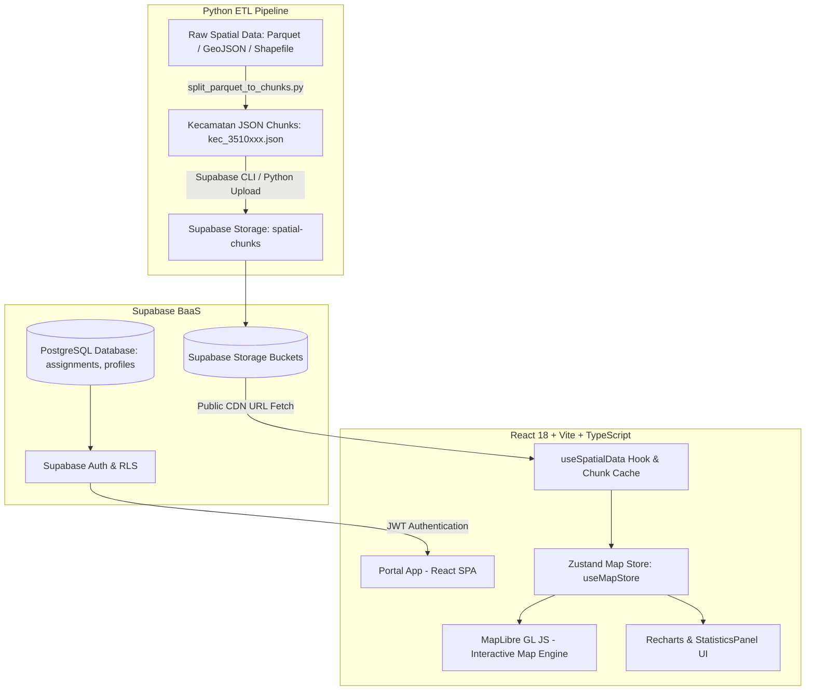

# 📘 Product Requirement Document (PRD) & Sistem Arsitektur
# Portal Pemetaan Spasial Tentoring Sensus Ekonomi 2026 (BPS Kabupaten Banyuwangi)

**Versi Dokumen**: 2.0 (Production Ready)  
**Tanggal Update**: 30 Juli 2026  
**Status**: Live / Production Approved  

---

## 1. 🎯 Ringkasan Eksekutif & Visi Proyek

### 1.1 Latar Belakang
Sensus Ekonomi 2026 (SE2026) yang diselenggarakan oleh Badan Pusat Statistik (BPS) membutuhkan sistem penjaminan kualitas spasial (*Spatial Quality Assurance*) yang presisi tinggi. Pemetaan spasial lapangan mengumpulkan ratusan ribu titik entitas usaha (Biasa, Digital, Pertanian), unit kediaman rumah tangga, serta geometri bangunan fisik di seluruh wilayah Kabupaten Banyuwangi.

### 1.2 Tujuan Utama Portal
1. **Visualisasi Spasial Berkinerja Tinggi**: Menyajikan data ratusan ribu entitas spasial secara *real-time* dan responsif menggunakan streaming chunk JSON per kecamatan.
2. **Monitoring Progress Pencacahan**: Menyajikan indikator statistik agregat (KPI), status kunjungan bangunan, rasio adopsi usaha digital, dan kepadatan spasial entitas per wilayah.
3. **Generasi Spasial Sintetis (*Synthetic Building Generator*)**: Mengatasi permasalahan titik lokasi usaha/RT yang tidak memiliki geometri bangunan fisik (*orphan points*) dengan membentuk geometri bujur sangkar presisi $6\text{m} \times 6\text{m}$ secara otomatis.
4. **Asosiasi Jarak & Snapping Entitas**: Menghubungkan titik usaha/keluarga di jalan ke centroid polygon bangunan terdekat berdasarkan toleransi jarak spasial $\le 15-20\text{ meter}$.
5. **Keamanan Berbasis Peran (*Role-Based Access Control*)**: Membatasi cakupan filter wilayah dan fitur ekspor data sesuai hierarki petugas BPS (Admin, PML/Pengawas, PPL/Pencacah).

---

## 2. 🏛️ Arsitektur Sistem & Teknologi Stack

### 2.1 High-Level System Architecture Diagram



### 2.2 Core Technology Stack

| Layer / Komponen | Teknologi yang Digunakan | Fungsi Utama |
| :--- | :--- | :--- |
| **Frontend Framework** | React 18, Vite 6, TypeScript 5 | Single Page Application (SPA) ultra-cepat dengan Strict Type Safety |
| **Styling & Design** | TailwindCSS v4, Lucide Icons, Fontsource Nunito Sans | Antarmuka clean, modern, responsif, dan konsisten |
| **Map Rendering Engine**| MapLibre GL JS v4 | Rendering peta 2D & 3D extrusion berkinerja tinggi berbasis Vector & GeoJSON |
| **State Management** | Zustand (`useMapStore`) | State terpusat untuk filter wilayah, toggle layer, opacity, & versi dataset |
| **Data Visualization** | Recharts | Donut/Pie Chart progress kunjungan & Bar Chart sebaran entitas |
| **UI Components** | Shadcn UI, Vaul (Drawer Primitive) | Floating bottom statistics sheet & komponen modal responsif |
| **Backend & Storage** | Supabase Auth, PostgreSQL, Supabase Storage | Authentication RBAC, tabel penugasan wilayah, dan streaming JSON chunks |
| **ETL / Preprocessing**| Python 3.10+ (GeoPandas, Shapely, PyArrow, Fiona) | Script pembagi dataset Parquet raksasa menjadi chunk kecil per kecamatan |
| **Testing Framework** | Vitest + React Testing Library | Unit testing untuk data processing, store management, dan komponen UI |
| **Deployment Target** | Vercel Serverless Platform | CI/CD deployment otomatis dengan verifikasi `tsc -b && vite build` |

---

## 3. 🗄️ Spesifikasi Data Source & Chunking Strategy

### 3.1 Supabase Storage Bucket Structure
Aplikasi memanfaatkan 2 bucket Supabase Storage utama:

1. **Bucket `spatial-chunks`**:
   - `usaha/kec_{idkec}.json` : Dataset Titik Usaha Biasa (non-pertanian).
   - `usaha_digital/kec_{idkec}.json` : Dataset Titik Usaha E-Commerce & Digital.
   - `usaha_pertanian/kec_{idkec}.json` : Dataset Titik Usaha Agrikultur & Tani.
   - `rumah_tangga/kec_{idkec}.json` : Dataset Titik Unit Keluarga (RT).
   - `bangunan/kec_{idkec}.json` : Dataset Geometri Polygon Bangunan Fisik (WKT).
   - `sls/kec_{idkec}.json` : Dataset Boundary GeoJSON Satuan Lingkungan Setempat (SLS).
   - **Versi Dataset SE2026**: Tersimpan di subfolder `se2026/{dataset}/kec_{idkec}.json`.

2. **Bucket `spatial-data`**:
   - `peta-kabupaten-banyuwangi.geojson` : Boundary polygon seluruh Kabupaten Banyuwangi.
   - `wilayah_manifest.json` : Manifest hierarki kode & nama Kecamatan/Desa se-Banyuwangi.

### 3.2 Formatter Geometri & WKT Parsing
- Data bangunan fisik dari database GIS disimpan dalam format **Well-Known Text (WKT)** (contoh: `POLYGON((114.35 -8.21, ...))`).
- Modul [`dataProcessing.ts`](file:///c:/Users/Acer/Desktop/terntoring-se2026/portal/src/utils/dataProcessing.ts) mengonversi WKT menjadi GeoJSON Polygon menggunakan library `wellknown`.
- Penentuan titik lokasi dalam polygon SLS memanfaatkan **Ray Casting Point-in-Polygon Algorithm** untuk melakukan *spatial join* secara presisi.

---

## 4. 📐 Fitur Generasi Bangunan Sintetis ($6\text{m} \times 6\text{m}$ Synthetic Building Generator)

### 4.1 Latar Belakang & Masalah
Saat melakukan survey di lapangan, terdapat titik-titik usaha atau rumah tangga yang berada di lokasi independen/pinggir jalan tanpa diselimuti oleh geometri polygon bangunan fisik asli (*orphan points*). Tanpa polygon bangunan, titik tersebut tidak dapat divisualisasikan sebagai objek 3D di peta.

### 4.2 Spesifikasi Matematika Spasial
Untuk memenuhi standar pemetaan SIG & Sensus BPS, sistem menghasilkan **bujur sangkar sintetis $6\text{ meter} \times 6\text{ meter}$ (luas $36\text{ m}^2$)** di sekeliling titik GPS tersebut.

#### Formula Offset Koordinat GPS (WGS84):
Di wilayah khatulistiwa / Jawa Timur (Kabupaten Banyuwangi):
$$1^\circ \text{ Lintang/Bujur} \approx 111,000 \text{ meter}$$
$$1 \text{ meter} \approx 0.000009^\circ \text{ derajat koordinat GPS}$$

Untuk membuat bujur sangkar dengan panjang sisi $S = 6 \text{ meter}$:
$$\text{Half Degrees } (\Delta) = \frac{S}{2} \times 0.000009^\circ = 3 \times 0.000009^\circ = 0.000027^\circ$$

#### Konstruksi 5 Titik Ring Polygon (Closed Loop):
Diberikan koordinat titik tengah $(lng, lat)$:
$$P_1 = (lng - \Delta, lat - \Delta)$$
$$P_2 = (lng + \Delta, lat - \Delta)$$
$$P_3 = (lng + \Delta, lat + \Delta)$$
$$P_4 = (lng - \Delta, lat + \Delta)$$
$$P_5 = P_1 = (lng - \Delta, lat - \Delta)$$

Fungsi di [`dataProcessing.ts`](file:///c:/Users/Acer/Desktop/terntoring-se2026/portal/src/utils/dataProcessing.ts):
```typescript
export function generateSyntheticBuildingForPoint(
  lat: number,
  lng: number,
  sizeMeters = 6
): any {
  const halfDegrees = (sizeMeters / 2) * 0.000009;
  const minLng = lng - halfDegrees;
  const maxLng = lng + halfDegrees;
  const minLat = lat - halfDegrees;
  const maxLat = lat + halfDegrees;

  return {
    type: "Polygon",
    coordinates: [[
      [minLng, minLat],
      [maxLng, minLat],
      [maxLng, maxLat],
      [minLng, maxLat],
      [minLng, minLat],
    ]],
  };
}
```

### 4.3 Visualisasi & Estetika OSM / OpenFreeMap
- **Warna Abu-Abu Netral (OSM Style)**: Menggunakan warna abu-abu netral (`#cbd5e1` di mode terang / `#334155` di mode gelap) agar tidak bertabrakan dengan warna titik indikator.
- **Tinggi Tapak Rendah (*Low-Profile Footprint*)**: Tinggi 3D extrusion diset sebesar **`1.8` meter** sehingga tampak seperti tapak bangunan dasar yang rapi.
- **Badge Popup Info**: Menampilkan penanda `✨ Generatif Spasial 6m × 6m` dengan properti `is_synthetic: true`.
- **Toggle Control**: Pengguna dapat mematikan/menyalakan layer ini melalui saklar `↳ Bangunan Buatan Sintetis (6m×6m)` di sidebar.

---

## 5. 🧮 Logika & Formula Matematika Snapping / Associating Points to Buildings

### 5.1 Penentuan Toleransi Jarak (Distance Threshold)
Ketika pengguna mengklik atau mengarahkan kursor (*hover*) pada suatu polygon bangunan fisik, sistem mencari titik-titik usaha/keluarga yang berada di dekat bangunan tersebut (misalnya di pinggir jalan depan bangunan).

Formula Jarak Euklidian Koordinat GPS di [`InteractiveMap.tsx`](file:///c:/Users/Acer/Desktop/terntoring-se2026/portal/src/components/dashboard/InteractiveMap.tsx):
$$dx = \text{lng}_{\text{point}} - \text{lng}_{\text{building\_centroid}}$$
$$dy = \text{lat}_{\text{point}} - \text{lat}_{\text{building\_centroid}}$$
$$\text{Distance Squared } (d^2) = dx^2 + dy^2 \le \text{maxDistance}^2$$

Dimana $\text{maxDistance} = 0.00015^\circ$ derajat koordinat GPS, yang setara dengan **jarak toleransi $15 - 20 \text{ meter}$ di lapangan**.

### 5.2 Dynamic Building Clustering & Popup HTML
- **Bangunan Usaha**: Jika hanya ditemukan titik usaha dalam radius $\le 15\text{m}$.
- **Bangunan Rumah Tangga**: Jika hanya ditemukan titik rumah tangga dalam radius $\le 15\text{m}$.
- **Bangunan Campuran**: Jika ditemukan kombinasi titik Usaha DAN titik Rumah Tangga dalam radius $\le 15\text{m}$. Popup akan menampilkan tab khusus *"Usaha (X)"* dan *"Keluarga (Y)"*.

---

## 6. 🎛️ Fitur Dashboard & Interface Spasial (UI/UX)

### 6.1 Layout Full-Screen & Floating Non-Modal Sheet
- **Map Container**: Memenuhi 100% tinggi layar (`h-screen overflow-hidden flex flex-col relative`).
- **Floating Mini-Bar**: Terletak di posisi **bottom-left** (`left-3 right-16 sm:left-6`), memastikan tombol kontrol zoom (+/-), kompas, dan fullscreen milik MapLibre di posisi bottom-right tetap 100% bebas dari halangan.
- **Expanded Floating Sheet**: Menampilkan panel statistik yang melayang hingga maksimal `58vh` tanpa backdrop blur yang menutupi area atas peta.

### 6.2 Kartu Indikator KPI & Metrik Spasial
1. **Total Bangunan**: Jumlah unit bangunan fisik terdata (% Dikunjungi & Terdata).
2. **Usaha Biasa**: Total titik usaha non-pertanian.
3. **Usaha Digital**: Total titik usaha berbasis e-commerce & toko online.
4. **Usaha Pertanian**: Total titik objek agrikultur, tani, & peternakan.
5. **Rumah Tangga**: Total unit kediaman keluarga (KK).
6. **Total Entitas Spasial**: Akumulasi seluruh titik terdaftar.
7. **Rasio Adopsi Usaha Digital**: Persentase adopsi digital $(\frac{\text{Usaha Digital}}{\text{Total Usaha}} \times 100\%)$.
8. **Kepadatan Spasial Entitas**: Rasio rata-rata entitas per unit bangunan $(\frac{\text{Total Entitas}}{\text{Total Bangunan}})$.

---

## 7. 🔐 Matriks Hak Akses & Keamanan Pengguna (RBAC)

Aplikasi menerapkan kontrol akses ketat berdasarkan tabel `assignments` dan `profiles` di Supabase:

| Role | Akses Filter Wilayah | Mode Komparasi | Export Excel / CSV |
| :--- | :--- | :--- | :--- |
| **Admin** | Seluruh Kabupaten Banyuwangi (25 Kecamatan) | ✅ Penuh | ✅ Penuh (Seluruh Kabupaten / Per-Wilayah) |
| **PML (Pengawas)** | Kecamatan & Desa Penugasan Spesifik | ✅ Penuh | ✅ Terbatas Wilayah Tugas |
| **PPL (Petugas)** | Desa Penugasan Spesifik (Single Village Scope) | ✅ Penuh | ❌ Khusus Admin & PML |

---

## 8. 🐍 Python Preprocessing & ETL Data Pipeline

File ETL berada di root repository untuk memproses dataset mentah sebelum di-stream ke frontend:

### 8.1 [`split_parquet_to_chunks.py`](file:///c:/Users/Acer/Desktop/terntoring-se2026/split_parquet_to_chunks.py)
- **Fungsi**: Membaca file Parquet / GeoJSON besar berukuran gigabyte, melakukan pembagian (*splitting*) per `idkec` (kode kecamatan 7 digit), dan menyimpan output JSON chunk kecil yang terkompresi.
- **Perintah Eksekusi**:
  ```bash
  python split_parquet_to_chunks.py --upload
  ```

### 8.2 [`preprocess_bangunan.py`](file:///c:/Users/Acer/Desktop/terntoring-se2026/preprocess_bangunan.py)
- **Fungsi**: Membersihkan geometri polygon bangunan, mengonversi koordinat proyeksi UTM ke WGS84 (EPSG:4326), dan mengekstrak centroid koordinat.

### 8.3 [`import_wilayah.py`](file:///c:/Users/Acer/Desktop/terntoring-se2026/import_wilayah.py)
- **Fungsi**: Membentuk `wilayah_manifest.json` yang berisi daftar struktur nama dan kode Kecamatan serta Desa di Banyuwangi.

---

## 9. 🧪 Pengujian & Penjaminan Kualitas (QA & Verification)

### 9.1 Vitest Unit Testing
Seluruh logika pengolahan data dan state management diuji secara otomatis via Vitest:
- `dataProcessing.test.ts` : Menguji kalkulasi bounding box, point-in-polygon assignment, dan pembentukan polygon bujur sangkar $6\text{m} \times 6\text{m}$.
- `mapStore.test.ts` : Menguji logika toggle layer, filter wilayah, dan reset state.
- `StatisticsModal.test.tsx` : Menguji proteksi role Admin/PML pada tombol ekspor data.

Perintah eksekusi test:
```bash
npm run test
```
**Status**: `10/10 Tests PASSED (3/3 Test Suites)`

### 9.2 Vercel Production Build Verification
Aplikasi diverifikasi bebas dari kesalahan tipe TypeScript dan unused imports:
```bash
npm run build
```
**Status**: `built in 1.38s (0 Errors / 0 Warnings)`

---

## 10. 📖 Panduan Eksekusi & Pengoperasian

### 10.1 Jalankan Environment Lokal
```bash
cd portal
npm install
npm run dev
```

### 10.2 Generasi Ulang Type Database Supabase
```bash
npm run gen:types
```

---

*Dokumentasi PRD ini disusun sebagai acuan teknis resmi pengembangan dan pemeliharaan Portal Pemetaan Spasial Sensus Ekonomi 2026.*
