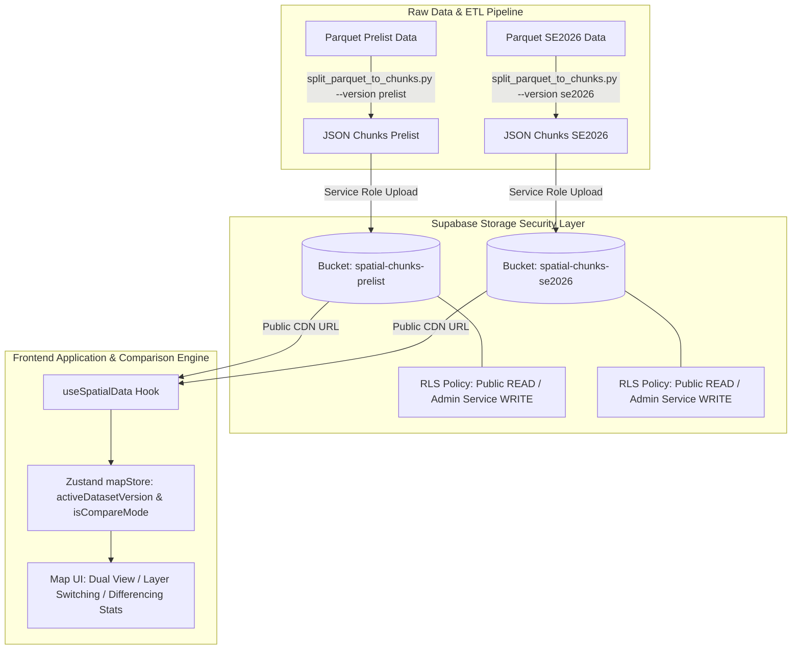

# Implementation Plan - Dual Storage Bucket Architecture (Prelist & SE2026) & Feature Komparasi

Menyediakan arsitektur **2 Storage Bucket Supabase** (`spatial-chunks-prelist` dan `spatial-chunks-se2026`) yang **secure**, **scalable**, dan **proper**, serta mempersiapkan integrasi **Fitur Komparasi Data (Prelist vs SE2026)** pada Portal Pemetaan Spasial BPS Kabupaten Banyuwangi.

---

## 🎯 User Review Required

> [!IMPORTANT]
> **Keputusan Strategis Bucket Storage**:
> 1. **Dua Bucket Terpisah**:
>    - `spatial-chunks-prelist`: Menyimpan chunk JSON hasil data awal / historis Prelist.
>    - `spatial-chunks-se2026`: Menyimpan chunk JSON hasil pencacahan / pemutakhiran SE2026 terbaru.
> 2. **Keamanan & Kebijakan Akses (RLS & Access Policy)**:
>    - **Public Read (SELECT)**: Terbuka untuk `anon` & `authenticated` agar Map Client (MapLibre GL JS) dapat melakukan CDN fetching ultra-cepat tanpa overhead JWT sign per chunk file.
>    - **Write / Upload / Delete (INSERT, UPDATE, DELETE)**: Terkunci total untuk publik. Hanya diperbolehkan menggunakan **Supabase Service Role Key** (pada Python ETL script) atau akun role `admin`.
> 3. **Batasan Bucket (Storage Security Constraints)**:
>    - **Allowed MIME Types**: `application/json`, `application/geo+json`.
>    - **Max File Size**: 50 MB per file chunk.

---

## 📐 Arsitektur & Desain Data



---

## 📋 Proposed Changes

---

### [Supabase Storage & Database RLS Policies]

#### [NEW] [storage_policies.sql](file:///c:/Users/Acer/Desktop/terntoring-se2026/supabase/storage_policies.sql)
- Skrip SQL DDL untuk membuat dan mengamankan bucket `spatial-chunks-prelist` dan `spatial-chunks-se2026`.
- Menerapkan Row Level Security (RLS) pada schema `storage.objects`:
  - `SELECT` policy untuk public read.
  - `INSERT`, `UPDATE`, `DELETE` policy restricted to Service Role & Admin.

---

### [ETL & Python Scripts]

#### [MODIFY] [split_parquet_to_chunks.py](file:///c:/Users/Acer/Desktop/terntoring-se2026/split_parquet_to_chunks.py)
- Menambahkan parameter CLI `--dataset-version [prelist|se2026]` (default: `prelist`).
- Secara otomatis menentukan bucket tujuan:
  - `--dataset-version prelist` -> bucket `spatial-chunks-prelist`
  - `--dataset-version se2026` -> bucket `spatial-chunks-se2026`
- Menyimpan file manifest (`_manifest.json` dan `wilayah_manifest.json`) ke dalam bucket yang relevan.
- Memastikan error handling & logging aman tanpa membocorkan Service Role Key.

#### [MODIFY] [cek_supabase.py](file:///c:/Users/Acer/Desktop/terntoring-se2026/cek_supabase.py)
- Menambahkan opsi CLI `--dataset-version [prelist|se2026]` atau `--version`.
- Mengizinkan verifikasi manifest dan inspeksi data chunk dari kedua bucket secara mandiri.

---

### [Frontend Application Integration (Portal)]

#### [MODIFY] [useSpatialData.ts](file:///c:/Users/Acer/Desktop/terntoring-se2026/portal/src/hooks/useSpatialData.ts)
- Mengubah fungsi `getChunksPublicUrl(path, version)` untuk menerima parameter versi dataset atau membacanya dari `activeDatasetVersion` di `mapStore`.
- Mendukung penarikan data paralel (side-by-side) dari **Prelist** dan **SE2026** saat `isCompareMode = true`.

#### [MODIFY] [mapStore.ts](file:///c:/Users/Acer/Desktop/terntoring-se2026/portal/src/store/mapStore.ts)
- Memastikan state `activeDatasetVersion` ('prelist' | 'se2026') dan `isCompareMode` (boolean) terhubung secara reaktif dengan fetcher data dan pemilih layer.

#### [NEW] [ComparisonPanel.tsx](file:///c:/Users/Acer/Desktop/terntoring-se2026/portal/src/components/dashboard/ComparisonPanel.tsx) (atau penyesuaian di `StatisticsPanel.tsx`)
- Komponen UI untuk menampilkan indikator perbandingan:
  - Total Usaha Prelist vs SE2026.
  - Usaha Baru (*New Entrants*), Usaha Tutup/Pindah, dan Usaha Tetap.
  - Perubahan Jumlah Rumah Tangga & Bangunan.

---

## 🛠️ Step-by-Step Execution Plan

### Step 1: Konfigurasi Bucket & Keamanan Supabase Storage
1. Buat SQL migration / script policy `storage_policies.sql` untuk 2 bucket:
   - `spatial-chunks-prelist`
   - `spatial-chunks-se2026`
2. Terapkan RLS policies:
   ```sql
   -- Allow Public Access to Read JSON Chunks
   CREATE POLICY "Public Read Access for Prelist"
   ON storage.objects FOR SELECT
   USING (bucket_id = 'spatial-chunks-prelist');

   CREATE POLICY "Public Read Access for SE2026"
   ON storage.objects FOR SELECT
   USING (bucket_id = 'spatial-chunks-se2026');

   -- Restrict Writes to Service Role / Admin
   CREATE POLICY "Admin Upload Access for Prelist"
   ON storage.objects FOR INSERT
   WITH CHECK (bucket_id = 'spatial-chunks-prelist' AND auth.role() = 'service_role');

   CREATE POLICY "Admin Upload Access for SE2026"
   ON storage.objects FOR INSERT
   WITH CHECK (bucket_id = 'spatial-chunks-se2026' AND auth.role() = 'service_role');
   ```

### Step 2: Update Python Pipeline (`split_parquet_to_chunks.py` & `cek_supabase.py`)
1. Update `split_parquet_to_chunks.py` dengan opsi `--dataset-version`.
2. Uji coba pemecahan chunk & upload sampel data Prelist dan SE2026.
3. Update `cek_supabase.py` untuk menguji query ke kedua bucket.

### Step 3: Upgrading Frontend State & Custom Hooks
1. Update `useSpatialData.ts` agar routing URL bucket bersifat dinamis:
   ```ts
   const getChunksPublicUrl = (path: string, version: 'prelist' | 'se2026' = activeDatasetVersion) => {
     const bucketName = version === 'se2026' ? 'spatial-chunks-se2026' : 'spatial-chunks-prelist';
     const { data } = supabase.storage.from(bucketName).getPublicUrl(path);
     return data.publicUrl;
   };
   ```
2. Integrasikan penarikan data ganda saat `isCompareMode` diaktifkan oleh pengguna.

### Step 4: Penambahan Fitur UI Komparasi
1. Buat/update komponen visualisasi komparasi (metrik perbandingan Prelist vs SE2026).
2. Sediakan toggle perbandingan di `SidebarControls.tsx`.

---

## 🧪 Verification Plan

### Automated Tests
- Menjalankan unit test frontend:
  ```bash
  npm --prefix portal test
  ```
- Menjalankan lint & type check:
  ```bash
  npm --prefix portal run build
  ```

### Manual & CLI Verification
1. **Verifikasi Keamanan Storage (RLS Test)**:
   - Jalankan `cek_supabase.py --version prelist` dan `cek_supabase.py --version se2026` untuk memastikan manifest dan chunk dapat dibaca via HTTP GET tanpa token header.
   - Uji HTTP POST/PUT tanpa Service Role Key ke bucket untuk memastikan ditolak (403 Forbidden / Unauthorized).
2. **Verifikasi Fitur Komparasi UI**:
   - Buka portal web di browser local (`npm run dev`).
   - Pindah toggle versi dataset dari `Prelist` ke `SE2026`.
   - Aktifkan mode `Komparasi` dan pastikan data dari kedua versi ter-load secara konsisten dan responsif.
